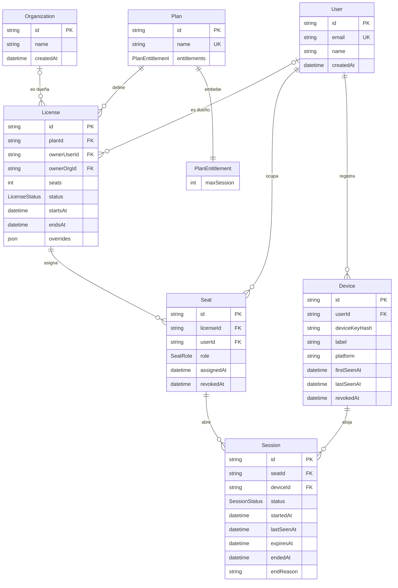

# Diagrama MER: licencias, asientos, dispositivos y sesiones

Modelo entidad-relación completo (MongoDB + Prisma). Incluye el control de sesiones máximas activas por asiento, con identificación del dispositivo del usuario.

## Diagrama

## Entidades nuevas

|Entidad|Descripción|Restricciones / índices|
|---|---|---|
|`Device`|Máquina o navegador registrado por un usuario. Se identifica con un hash (`deviceKeyHash`), nunca con el ID crudo.|Único `(userId, deviceKeyHash)`|
|`Session`|Sesión abierta en un dispositivo, asociada a un asiento.|Índices `(seatId, status, expiresAt)` y `(deviceId, status)`; `onDelete: Cascade` desde `Seat` y `Device`|

## Enums

|Enum|Valores|
|---|---|
|`LicenseStatus`|`TRIAL`, `ACTIVE`, `PAST_DUE`, `GRACE`, `SUSPENDED`, `EXPIRED`, `CANCELED`|
|`SeatRole`|`STUDENT`, `TEACHER`, `ADMIN`|
|`SessionStatus`|`ACTIVE`, `ENDED`, `EXPIRED`, `REVOKED`|

## Relaciones y cardinalidades

|Relación|Cardinalidad|Notas|
|---|---|---|
|`User` → `License`|0..1 a 0..N|`ownerUserId` es opcional|
|`Organization` → `License`|0..1 a 0..N|`ownerOrgId` es opcional|
|`Plan` → `License`|1 a 0..N|`planId` obligatorio|
|`Plan` → `PlanEntitlement`|1 a 1|Documento embebido|
|`License` → `Seat`|1 a 0..N|Cascada al eliminar|
|`User` → `Seat`|1 a 0..N|`Seat` resuelve la relación N:M entre `License` y `User`|
|`User` → `Device`|1 a 0..N|Un usuario puede tener varios dispositivos|
|`Seat` → `Session`|1 a 0..N|El límite se mide por asiento|
|`Device` → `Session`|1 a 0..N|Una sola sesión activa por dispositivo|

## Cómo se controlan las sesiones máximas

- **Límite efectivo:** `License.overrides.maxSession ?? Plan.entitlements.maxSession`.
- **Sesión activa:** `status = ACTIVE` y `expiresAt > now`. Cada heartbeat o refresh de token extiende `expiresAt`.
- **Una sesión por dispositivo:** al iniciar sesión se cierra la sesión activa previa del mismo `Device`, así el límite equivale a dispositivos simultáneos.
- **Flujo de login:**
    1. Validar que el `Seat` no esté revocado y que la licencia esté en `TRIAL`, `ACTIVE` o `GRACE` y dentro de `startsAt` y `endsAt`.
    2. Hacer upsert del `Device` por `(userId, deviceKeyHash)`.
    3. Cerrar la sesión activa previa de ese dispositivo.
    4. Contar las sesiones activas del asiento.
    5. Si el conteo es menor al límite, crear la sesión. Si no, rechazar mostrando los dispositivos activos, o expulsar la de `lastSeenAt` más antiguo.
- **Concurrencia:** hacer el conteo y la inserción dentro de un `$transaction` (MongoDB requiere replica set), o insertar y recontar, deshaciendo si se pasó el límite.
- **Revocaciones:** al revocar un `Seat` o suspender o expirar la licencia, cerrar sus sesiones con un `endReason`.

## Identificador del dispositivo

- **Web:** UUID aleatorio generado por el servidor la primera vez, guardado en una cookie `httpOnly` firmada.
- **App de escritorio:** ID de máquina del sistema operativo, pasado por HMAC con una clave propia.
- **Almacenamiento:** solo el hash en `deviceKeyHash`.
- **Limitación:** si el usuario borra las cookies, cuenta como dispositivo nuevo. Por eso se cuentan sesiones, y el usuario puede ver y cerrar sus dispositivos.

## Supuesto de diseño

El límite se aplica por usuario (por `Seat`): cada persona de la licencia puede tener hasta `maxSession` dispositivos a la vez. Si prefieres un cupo compartido por toda la licencia, `Session` se asocia a `License` en lugar de `Seat`, y el conteo se hace sobre todos los asientos de la licencia.