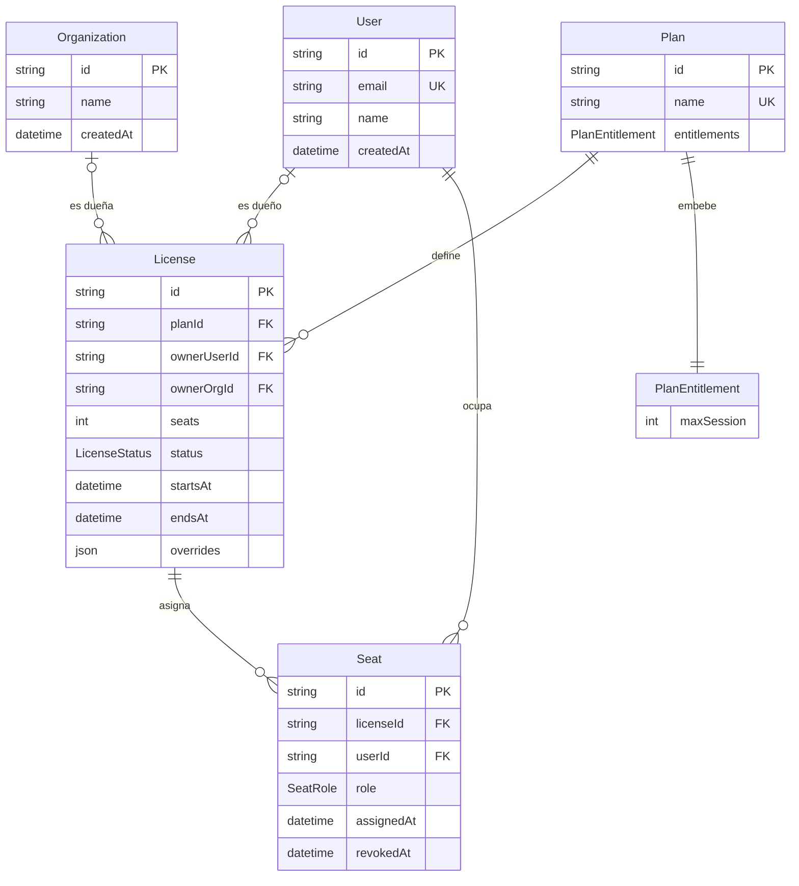

# Diagrama MER: licencias y asientos

Modelo entidad-relación del esquema Prisma (MongoDB) para usuarios, organizaciones, planes, licencias y asientos.

## Diagrama



## Entidades

|Entidad|Descripción|Restricciones / índices|
|---|---|---|
|`User`|Persona del sistema.|`email` único|
|`Organization`|Organización que puede ser dueña de licencias.||
|`Plan`|Plan comercial con sus entitlements.|`name` único|
|`PlanEntitlement`|Tipo compuesto embebido en `Plan` (no es colección). Campo: `maxSession`.||
|`License`|Licencia de un plan, propiedad de un usuario o de una organización.|Índices: `ownerUserId`, `ownerOrgId`, `(status, endsAt)`|
|`Seat`|Asignación de un usuario a una licencia.|Único `(licenseId, userId)`; índice `(userId, revokedAt)`; `onDelete: Cascade` desde `License`|

## Enums

|Enum|Valores|
|---|---|
|`LicenseStatus`|`TRIAL`, `ACTIVE`, `PAST_DUE`, `GRACE`, `SUSPENDED`, `EXPIRED`, `CANCELED`|
|`SeatRole`|`STUDENT`, `TEACHER`, `ADMIN`|

## Relaciones y cardinalidades

|Relación|Cardinalidad|Notas|
|---|---|---|
|`User` → `License`|0..1 a 0..N|`ownerUserId` es opcional|
|`Organization` → `License`|0..1 a 0..N|`ownerOrgId` es opcional|
|`Plan` → `License`|1 a 0..N|`planId` obligatorio|
|`License` → `Seat`|1 a 0..N|Se eliminan en cascada|
|`User` → `Seat`|1 a 0..N|`Seat` es la tabla intermedia entre `License` y `User` (N:M)|
|`Plan` → `PlanEntitlement`|1 a 1|Documento embebido|

## Notas de diseño

- El esquema no obliga a que una licencia tenga exactamente un dueño: `ownerUserId` y `ownerOrgId` pueden estar ambos vacíos o ambos llenos. Si quieres esa regla, hay que validarla en la aplicación.
- `Seat.revokedAt` permite revocar asignaciones sin borrarlas, conservando el historial.
- En MongoDB con Prisma, los `id` suelen declararse como `@id @default(auto()) @map("_id") @db.ObjectId`. Con `cuid()` funciona, pero los ids son `String` y no `ObjectId`.


# Modelo relacional: licencias y asientos

Derivado del MER del esquema Prisma. Notación: <u>subrayado</u> = clave primaria (PK), `#` = clave foránea (FK), `UK` = clave única.

## Esquema relacional (notación abreviada)

```
USER          ( id, email, name, createdAt )
                PK: id
                UK: email

ORGANIZATION  ( id, name, createdAt )
                PK: id

PLAN          ( id, name, entitlements_maxSession )
                PK: id
                UK: name

LICENSE       ( id, #planId, #ownerUserId, #ownerOrgId, seats, status,
                startsAt, endsAt, overrides )
                PK: id
                FK: planId       → PLAN(id)
                FK: ownerUserId  → USER(id)          (nulo permitido)
                FK: ownerOrgId   → ORGANIZATION(id)  (nulo permitido)

SEAT          ( id, #licenseId, #userId, role, assignedAt, revokedAt )
                PK: id
                FK: licenseId → LICENSE(id)  ON DELETE CASCADE
                FK: userId    → USER(id)
                UK: (licenseId, userId)
```

> `PlanEntitlement` es un tipo compuesto embebido en `Plan`. En el modelo relacional se aplana como el atributo `entitlements_maxSession`. Si más adelante el tipo crece, puede convertirse en una tabla `PLAN_ENTITLEMENT(planId PK/FK, maxSession, ...)` con relación 1:1.

## Tablas detalladas

### USER

|Atributo|Tipo|Nulo|Restricción|
|---|---|---|---|
|`id`|String (cuid)|No|PK|
|`email`|String|No|UK|
|`name`|String|No||
|`createdAt`|DateTime|No|Default `now()`|

### ORGANIZATION

|Atributo|Tipo|Nulo|Restricción|
|---|---|---|---|
|`id`|String (cuid)|No|PK|
|`name`|String|No||
|`createdAt`|DateTime|No|Default `now()`|

### PLAN

|Atributo|Tipo|Nulo|Restricción|
|---|---|---|---|
|`id`|String (cuid)|No|PK|
|`name`|String|No|UK|
|`entitlements_maxSession`|Int|No|Aplanado de `PlanEntitlement.maxSession`|

### LICENSE

|Atributo|Tipo|Nulo|Restricción|
|---|---|---|---|
|`id`|String (cuid)|No|PK|
|`planId`|String|No|FK → `PLAN.id`|
|`ownerUserId`|String|Sí|FK → `USER.id`|
|`ownerOrgId`|String|Sí|FK → `ORGANIZATION.id`|
|`seats`|Int|No|Default `1`|
|`status`|`LicenseStatus`|No|Default `ACTIVE`|
|`startsAt`|DateTime|No|Default `now()`|
|`endsAt`|DateTime|No||
|`overrides`|Json|Sí||

Índices: `(ownerUserId)`, `(ownerOrgId)`, `(status, endsAt)`.

### SEAT

|Atributo|Tipo|Nulo|Restricción|
|---|---|---|---|
|`id`|String (cuid)|No|PK|
|`licenseId`|String|No|FK → `LICENSE.id`, `ON DELETE CASCADE`|
|`userId`|String|No|FK → `USER.id`|
|`role`|`SeatRole`|No|Default `STUDENT`|
|`assignedAt`|DateTime|No|Default `now()`|
|`revokedAt`|DateTime|Sí||

Restricción única: `(licenseId, userId)`. Índice: `(userId, revokedAt)`.

## Dominios (enums)

|Dominio|Valores|
|---|---|
|`LicenseStatus`|`TRIAL`, `ACTIVE`, `PAST_DUE`, `GRACE`, `SUSPENDED`, `EXPIRED`, `CANCELED`|
|`SeatRole`|`STUDENT`, `TEACHER`, `ADMIN`|

## Claves foráneas

|Tabla origen|Columna|Tabla destino|Obligatoria|Al eliminar|
|---|---|---|---|---|
|`LICENSE`|`planId`|`PLAN`|Sí|Por defecto de Prisma|
|`LICENSE`|`ownerUserId`|`USER`|No|Por defecto de Prisma|
|`LICENSE`|`ownerOrgId`|`ORGANIZATION`|No|Por defecto de Prisma|
|`SEAT`|`licenseId`|`LICENSE`|Sí|`CASCADE`|
|`SEAT`|`userId`|`USER`|Sí|Por defecto de Prisma|

## Cardinalidades

- `PLAN` 1 — N `LICENSE`
- `USER` 0..1 — N `LICENSE` (dueño individual)
- `ORGANIZATION` 0..1 — N `LICENSE` (dueña institucional)
- `LICENSE` 1 — N `SEAT`
- `USER` 1 — N `SEAT`
- `LICENSE` N — M `USER`, resuelta mediante la tabla `SEAT`

## Observaciones

- **Dueño de la licencia:** nada impide que `ownerUserId` y `ownerOrgId` estén ambos nulos o ambos llenos. Si el negocio exige exactamente uno, hay que validarlo en la aplicación. En un motor SQL sería un `CHECK` de tipo "uno u otro".
- **Normalización:** el modelo está en 3FN. No hay dependencias transitivas, y los datos del plan viven solo en `PLAN`.
- **Cupos:** `LICENSE.seats` es la capacidad. La cantidad de asientos en uso se obtiene contando filas de `SEAT` con `revokedAt` nulo, y el esquema no impide excederla.
- **MongoDB:** las claves foráneas no se aplican en la base de datos. Prisma las emula en su capa, por lo que la integridad referencial depende de pasar siempre por el cliente.